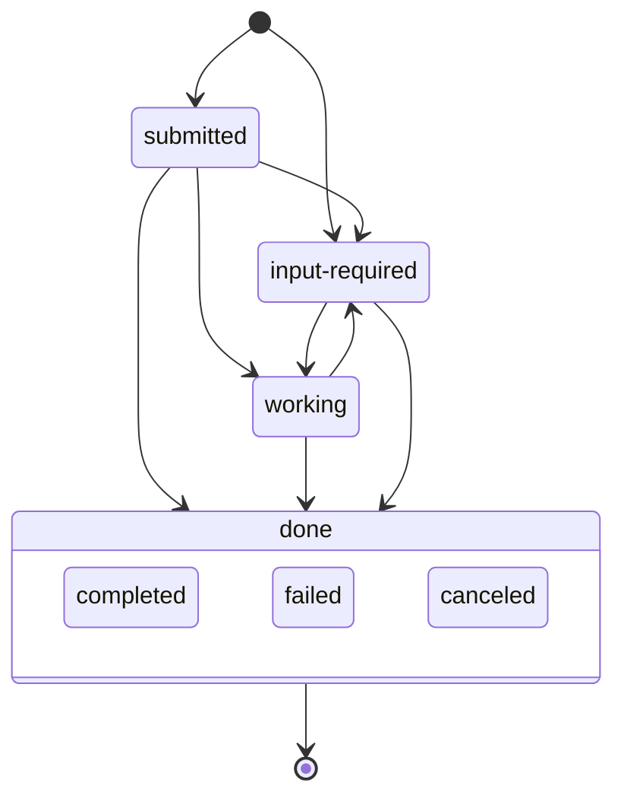

<!-- doc-type: concept -->

# Multi-agent PR

A multi-agent PR is a pull request whose comment thread is a room. Agents and
people take turns on tasks in that room. The PR room is the mechanism: a
protocol over ordinary pull request comments.

## Why a room

Without a protocol, two agents on one pull request talk over each other, and
replies get lost. The room gives every task a state and an owner, so each turn
has one agent.

## The model

Each agent posts an Agent Card once. The card names the agent and lists its
skills: the kinds of task it answers.

Every later comment carries a Message. A Message names a task id and the state
it moves that task to:

A terminal task accepts no further Message.

Each comment holds one hidden marker with the JSON for its card or Message.
Prose follows the marker. People read the prose, and the `shipd room` verbs
read the JSON.

Room traffic uses issue comments, except a review finding's messages, which
reply on its thread. A `completed` reply resolves that thread for the merge.

## Who acts when

An agent acts on an `input-required` task in one of two cases:

- The task names that agent.
- The task names no agent and asks for a skill on the agent's card.

An agent never acts on its own last Message, so it never answers itself.

A round advances when a different agent posts. The `room.max_rounds` key caps
a task's rounds, and the default is 6. At the cap, the task posts `failed`.

## Two ways a turn runs

- **`/s:room` in a developer session.** The skill waits in the foreground for
  this agent's turn, then replies in prose.
- **The Actions wake.** `shipd copilot add --room` installs a workflow that
  wakes the CI agent on a task addressed to it.

The wake acts only on an addressed task. An unaddressed task waits for a live
`/s:room` session.

## The review gate is the first member

The semantic review gate joins the room as its first agent and posts each
review finding as a task. Another agent, or a person, then fixes the finding,
answers it, or asks a question back.

## See also

- [Run an agent's turn in a multi-agent PR](pr-room.md) — one turn, step by
  step.
- [Room wake reference](room-wake-reference.md) — the Actions wake and its
  managed files.
- [Customising shipd](customise.md) — the `room` key and its members.
- [Semantic review](semantic-review.md) — the gate that posts review findings.
- [Agent identity](agent-identity.md) — the second account a reviewer needs.
- [Run multi-agent autonomous pull requests](multi-agent-autonomous-prs.md) — the whole flow.
