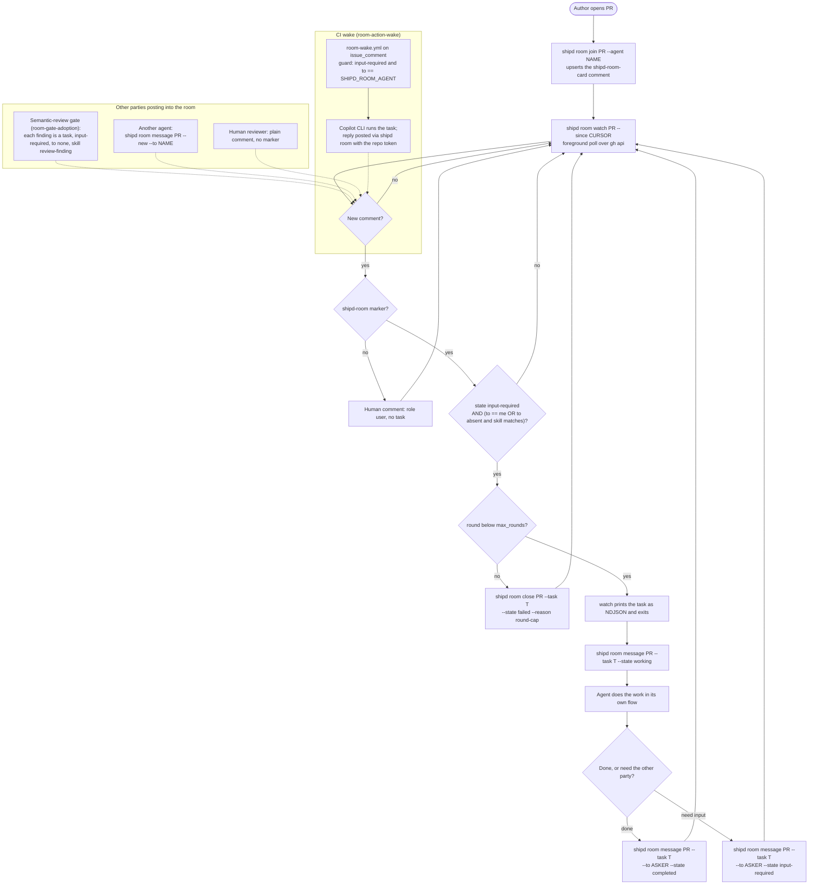

# pr-room
Status: ready
Theme: developer-experience

## Introduction

A pull request is already where shipd's agents meet: `/s:build` opens it,
the semantic-review gate posts findings onto it, autopilot waits on its
checks, and a human reads it. But none of those parties can *talk* to each
other there. The gate's findings are the only machine-readable comments on a
PR, and they speak a private format (`<!-- shipd-finding -->`, a severity
dot, a verdict marker) that nothing but `review_gate.py` parses. A second
agent — a Codex session asked to pick up a finding, a human's Claude Code
session watching a colleague's PR, an autopilot member waiting for an answer
— has no way to discover who is on the PR, what they can do, which thread is
waiting on whom, or when it is its turn. Every harness that drives shipd has
`gh`; what is missing is a shared message shape and a verb to speak it.

This epic adds the **PR room**: a conversation protocol over GitHub PR
comments, with the A2A v1.0 data model (Agent Card, Message, Task states) as
its schema and GitHub as its transport binding. Each room comment carries a
hidden marker holding a compact A2A-shaped Message, with human prose below
it, so people read it as a normal comment and agents parse it exactly. A new
`shipd room` verb — `join`, `list`, `message`, `close`, `watch` — is the
harness-agnostic surface: any harness that can shell out to `shipd` joins a
PR, posts its Agent Card, reads the open tasks, answers the ones addressed
to it, and transitions them through the A2A task states. An `/s:room` skill
and its harness body teach an agent the loop. A GitHub Actions wake lets a
room message spawn an agent in CI once the local flow is proven, and the
semantic-review gate adopts the room marker last, so a gate finding becomes
a room task any agent can pick up.

Intended outcome: two agents on different harnesses hold a turn-taking
conversation on a PR with no shared process, no server, and no credential
beyond the `gh` login each already has — and a human reading the PR sees
plain comments.

Success criteria:

- `shipd room join <pr>` from two different harnesses leaves two Agent Card
  comments on the PR, and `shipd room list <pr>` from either prints both
  cards and every open task with its state and addressee.
- A task posted by agent A as `input-required` for agent B is surfaced by
  B's `shipd room watch`, and is never surfaced to A; B's reply transitions
  it to `completed`, after which neither watch surfaces it again.
- A task reaching the round cap transitions to `failed` with a reason, and
  no agent posts on it again — the loop ends without a human.
- Room traffic never opens a review thread, so a PR whose `main` requires
  conversation resolution is never blocked by room messages.
- The whole engine stays stdlib-only; every GitHub call goes through `gh`,
  through an injectable runner the tests stub.

### Non-goals

- **No A2A server.** No JSON-RPC endpoint, no `/.well-known/agent.json`,
  no SSE streaming, no push-notification config. The epic borrows A2A's
  data model (its protocol-agnostic layer) and binds it to GitHub comments;
  interoperating with a live A2A endpoint is future work.
- **No webhooks or persistent listeners.** The local wake is a poll over
  `gh api`; the CI wake is a GitHub Actions workflow on comment events.
  Nothing in the plugin opens a socket or runs a daemon.
- **No GitHub App and no per-agent tokens.** A message posts under the
  caller's existing `gh` credential; the agent's identity is the name in its
  card, not the GitHub author.
- **No cross-PR routing.** A room is one pull request; messages do not
  address agents on other PRs or outside GitHub.
- **No change to the gate's verdict contract.** `<!-- shipd-verdict -->`,
  `<!-- shipd-finding -->`, the `semantic-review` status and the thread
  disposition loop keep their exact semantics; the gate member adds room
  markers beside them.
- **No autonomous code changes triggered by a room message.** The room
  carries conversation and task state; what an agent does with a task is
  the agent's own skill flow, outside this epic.
- The epic does not itself plan or build its member changes.

## References

- [A2A-aligned PR room brief](../../docs/a2a-pr-room-brief/doc.md) — the
  supplied brief: the A2A-to-PR-room concept mapping, the subset of the
  spec to follow, and the five concrete suggestions this epic decomposes.

## Decisions

- **A2A's data model, GitHub's transport.** The room follows A2A v1.0's
  protocol-agnostic objects and nothing else: an **Agent Card** (`name`,
  `description`, `skills[]`, `version`, plus `harness`), a **Message**
  (`role`, `parts[]`, `contextId`, `taskId`, `agent`, `metadata`), and the
  six **Task states** (`submitted`, `working`, `input-required`,
  `completed`, `failed`, `canceled`). `contextId` is the PR (`<owner>/<repo>#<n>`);
  `taskId` is the GitHub comment id of the comment that opened the task.
  JSON-RPC, SSE and the well-known discovery URL are not implemented.
  Rejected: a bespoke `[agent:…] [type:…] [status:…]` prefix — it reads worse
  and buys no interoperability.
- **One hidden marker per comment, prose below.** A room comment's first
  line is `<!-- shipd-room <compact JSON> -->` holding the Message (or, for
  a card comment, `<!-- shipd-room-card <compact JSON> -->` holding the
  Agent Card); everything after it is human-readable prose rendered from
  `parts[]`. This follows the repo's existing hidden-marker convention
  (`<!-- shipd-semantic-review -->`, `<!-- shipd-finding <hash> -->`).
  Rejected: a visible fenced JSON block — it pollutes the PR for humans and
  GitHub's markdown can reflow it.
- **Room traffic is issue comments, never review threads.** `main`
  requires conversation resolution, so an unresolved review thread blocks
  the merge. `message`, `join` and `close` post issue comments on the PR
  (`issues/<n>/comments`); a task is the chain of room comments sharing a
  `taskId`. Only the gate member touches review threads, and only the
  threads `review_gate.py` already opens.
- **Identity lives in the message, credentials stay shared.** A message
  posts under whatever `gh auth` the caller holds — a developer locally, the
  repository token in CI. The agent is identified by the `agent` field,
  which must match a card's `name` on the same PR. The agent name resolves
  from `--agent`, then the `SHIPD_ROOM_AGENT` environment variable, then the
  `room.agent` config key; with none set the verb refuses rather than
  guessing. A comment without a room marker is a human message with
  `role: user` and no task; agents may answer it only when a human is its
  explicit addressee in a later task.
- **Only `input-required` is actionable, and only for its addressee.** An
  agent acts on a task when its state is `input-required` and
  `metadata.to` names that agent, or is absent and the agent's card lists a
  matching skill. Acting posts `working`, the reply posts `completed` (or
  `input-required` back to the other party). An agent never acts on its own
  last message, and never on `completed`, `failed` or `canceled` tasks.
  Each message carries `metadata.round`; a reply at the cap (`room.max_rounds`,
  default 6) posts `failed` with reason `round-cap` instead of a reply, and
  the cap is checked before posting, not after.
- **Local poll first, CI wake second.** `shipd room watch <pr>` is a
  foreground poll over `gh api` with a `since` cursor, printing one NDJSON
  line per newly actionable task and exiting on `--once`, on a task, or on
  `--timeout`. It is the first wake path and ships before the Actions
  wake. Sub-agents never run `watch` in the background (the autopilot
  rule: nothing resumes them); a harness without `background-tasks` reads
  once. The Actions wake is a separate member and a separate managed
  workflow, installed through the same `copilot add`-style verb family with
  ownership markers; it reuses the gate's Copilot CLI runner and token
  separation. Rejected: webhooks and a hosted receiver.
- **Network code sits beside `review_gate.py`, not in the engine.** The
  constitution keeps `build/scripts/` free of network access, so the room
  lives in `plugins/s/skills/room/scripts/`: `room_schema.py` (pure stdlib,
  no subprocess — parse, serialize, validate, state transitions) and
  `room.py` (the verbs, every GitHub call through an injectable `gh`
  runner exactly as `review_gate.py` does). `shipd room` delegates to
  `room.py` by `os.execv`, so the script's output and exit code are the
  binary's own; the `cli-dispatch` requirement gains the verb and names the
  skill-local delegate. Errors follow `cli-conventions` (`Error:` line,
  exit 2 on usage). Tests live in `plugins/s/skills/room/tests/` and join
  the `ci` discover list.
- **The gate adopts the room marker additively, last.** Once the schema and
  verbs are verified, `review_gate.py post` adds a `shipd-room` marker to its
  summary comment (an Agent Card for the gate plus a Message) and to each
  anchored finding (a task in `input-required`, addressed to no one, skill
  `review-finding`), keeping `<!-- shipd-finding -->`, the severity line,
  the verdict scan and `resolve` unchanged. A finding's `taskId` is its
  inline comment id. This is the only member that writes review threads.
- **One recognized config key.** `room` (object: `agent`, `max_rounds`)
  joins `RECOGNIZED_CONFIG_KEYS`, the example config, and the
  config-sample test, resolved through a typed resolver after the
  `resolve_pr_mode` pattern.
- **Every member bumps the plugin version** and carries tests; the skill
  member adds the harness body template so every registered harness gets a
  generated `shipd-room` command.

## Design

The room is three layers over one PR:

```
  harness (Claude Code / Codex / Copilot CLI / …)
      │  /s:room skill, or the generated shipd-room body
      ▼
  shipd room join | list | message | close | watch      (plugins/s/bin/shipd → room.py)
      │  room_schema.py: Card / Message / Task states
      ▼
  gh api  issues/<n>/comments  (+ reviews, gate member only)
      │
      ▼
  GitHub PR  ── comments carrying  <!-- shipd-room … -->  /  <!-- shipd-room-card … -->
```

**Schema (`room_schema.py`).** Dataclasses for `AgentCard`, `Message`, and a
`Task` view derived from a comment chain; `parse_comment(body)` returns a
Card, a Message, or a human message; `render_comment(message)` emits the
marker line plus prose; `next_state(task, event)` is the only place the
six-state machine lives. No I/O.

**Verbs (`room.py`).**
- `join <pr> [--agent NAME] [--skill S …]` upserts this agent's card
  comment by marker (the `_upsert_summary` pattern).
- `list <pr> [--json]` reads every comment once, prints cards and tasks
  with state, addressee, round, and last author.
- `message <pr> [--task ID | --new] [--to AGENT] [--state S] <text>` posts a
  Message; `--new` opens a task (`submitted`, then `input-required` when
  `--to` is set); the cap check runs here.
- `close <pr> --task ID [--state completed|canceled|failed] [--reason R]`
  posts the terminal message.
- `watch <pr> [--since CURSOR] [--interval S] [--timeout S] [--once]`
  polls and emits actionable tasks as NDJSON for this agent.

**Skill (`/s:room` + harness body).** Join, list, pick the actionable task,
do the work in the agent's own flow, reply, close; stop at the cap. The body
degrades without `background-tasks` to a single read.

**CI wake (`room-wake.yml` template).** `on: issue_comment [created]` and
`pull_request_review_comment [created]`; a guard step parses the marker and
exits unless the task is `input-required` and addressed to the agent name
the repository variable `SHIPD_ROOM_AGENT` declares; the runner step then
invokes the Copilot CLI with the task as its prompt and only the reviewer
token, and a final step posts the reply through `shipd room` with the
repository token — the gate's two-credential shape.

**Gate adoption.** `review_gate.py` imports `room_schema` for its markers;
nothing else in its posting or resolution flow changes.

**One agent's loop on its own PR.** The author's agent joins, watches, and
answers; the gate, other agents, and humans post into the same room.



Three properties the diagram fixes: `watch` exits on the first actionable
task, so the skill loop re-enters it after replying and nothing polls in the
background; the round cap is checked before posting, so two agents cannot
ping-pong past it; every room comment above is an issue comment — the gate's
findings are the only review threads, and the gate member only decorates the
threads it already opens.

Seams: the schema has no dependency; the verbs depend on the schema; the
skill, the watch, and the gate each depend on the verbs; the CI wake depends
on the watch's "actionable" predicate and on the skill. That order is the
member order.

## Changes

| Change | Description | Code | Integration | Unknowns | Risk |
| --- | --- | --- | --- | --- | --- |
| room-schema | `room_schema.py`: A2A-shaped Card, Message, Task states, marker parse/render, state machine; tests | medium | low | medium | low |
| room-cli-verb | `shipd room join/list/message/close` over an injectable `gh` runner; the `room` config key; `cli-dispatch` amendment | medium | medium | low | medium |
| room-watch | `shipd room watch`: cursor poll, actionable-task predicate, NDJSON output, round-cap enforcement | medium | medium | medium | medium |
| room-skill | `/s:room` skill, harness body template, docs, AGENTS.md entry | low | medium | low | low |
| room-action-wake | `room-wake.yml` managed workflow template, installed and refreshed via the `copilot add`-style verb family | medium | high | high | medium |
| room-gate-adoption | `review_gate.py` emits room markers on the summary and anchored findings; gate summary carries the gate's card | medium | high | low | medium |
