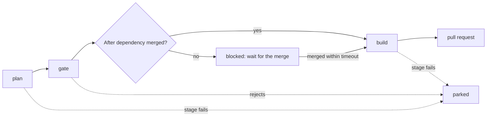

<!-- doc-type: how-to -->

# Autopilot

Autopilot drives an approved epic's members to shipped pull requests with no
human present. Each member gets one worktree and one branch. The epic
approval is the last human gate: after it, autopilot plans, gates, builds,
and ships each member on its own.

## When to use it

Use autopilot after an epic reaches `ready` or `active` and you want its
members delivered unattended. To plan every member first and settle their
questions in one round, run [Epic grill](epic-grill.md) before it. To write
or approve the epic, see [Epics](epics.md).

Autopilot runs in one of two modes:

- **In-session drive** — the default. The skill drives the members inside
  your session, in waves. It drives `unplanned` members from the plan stage
  and `ready` members from the build stage.
- **Detached run** — request it as `/s:autopilot <epic> detached`. A headless
  driver runs in the foreground and drives `unplanned` members one at a time.

Each mode reports every other member state and leaves that member alone.

## How to run it

1. **Launch preflight.** Run `/s:autopilot <epic>`. The skill prints one
   `ok`, `warn`, or `fail` line for each check. One `fail` line stops the
   run before it drives anything. A `warn` line does not block.
2. **Launch brief.** The skill prints the mode, each resolved control, the
   member order, and every `warn` line. For an in-session drive, it also
   prints the waves and any blocked members.
3. **Drive.** Autopilot walks each member through its pipeline. The run asks
   no question. A failure parks the member, and the drive continues with
   every member that does not depend on it.
4. **Run summary.** The skill reports four groups: shipped, parked, blocked,
   and skipped. A shipped member carries its full pull request URL. A parked
   member carries its reason and a resume pointer.

To watch the run live, run `shipd board --epic <epic>` from another terminal.
The board is read-only and never touches the run.

### One member's path

A `ready` member enters at the build stage. An unmerged `After` dependency
blocks the member. The drive waits for that merge within the
timeout, then builds the member. Before each build, autopilot runs the same
check as [Drift](drift.md).

### Resume a run

Re-run `/s:autopilot <epic>` to resume an interrupted run. Autopilot keeps no
run-state file. It reads each member's state from disk and re-enters the
member at the matching stage.

For a parked member, apply the remedy its pointer names, then re-run. A
detached run prints a `claude --resume <session-id>` command for a member
that needs a human. Run that command to reopen the session.

## Reference

| control | what it sets | default |
| --- | --- | --- |
| `--max-members` | The most members one run drives. | unlimited |
| `--timeout` | The time budget for each session, in seconds. | 1800 |
| `--max-resumes` | The resumed turns a session may spend. | 4 |
| `--parallel` | The members one in-session wave runs together. | 3 |

The detached run ignores `--parallel` and stays serial. You can also name a
control in words: "just the first spec" sets `--max-members 1`, and "serial"
sets `--parallel 1`.

A member parks for one of these reasons:

- `grade-failed <stage>` — a stage failed its grade.
- `gate-rejected` — the gate rejected the plan.
- `command-failed` — a configured command step exited non-zero.
- `sync-conflict` — the merge of `main` into the worktree conflicted.
- `drift-error` — the drift check could not run or returned no verdict.
- `drift-conflict` — the drift verdict contradicts a settled decision.
- `replan-failed` — the re-plan after a `revise` verdict did not pass.

The recovery for a `gate-rejected` or `replan-failed` member is
`/s:plan <member>`. The [Customising shipd](customise.md) page owns the
stage configuration of the pipeline.

See also:

- [Epics](epics.md) — write and approve the epic.
- [Epic grill](epic-grill.md) — plan every member before the run.
- [Drift](drift.md) — the check that runs before each build.
