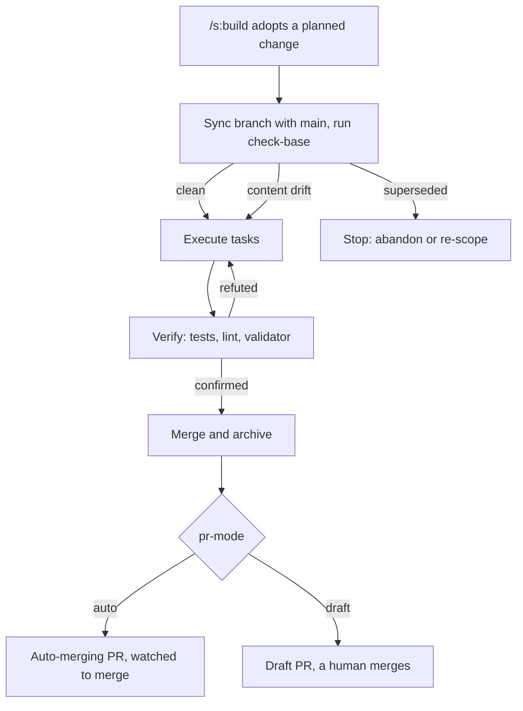

<!-- doc-type: how-to -->

# Build a change

`/s:build` executes a planned change task by task, verifies it, and ships it
as a pull request. The skill runs as an orchestrator on the session's model.
The orchestrator plans, coordinates, and verifies; it never writes the final
implementation code itself. Execution sub-agents, one model tier below the
session's model, implement the tasks.

## When to use it

- **Build a planned change.** [`/s:plan`](plan.md) emitted a change, and you want it
  implemented and shipped.
- **Build from a clear request.** When the request and the repository already
  meet the plan readiness checklist, the orchestrator authors the spec itself.
  Otherwise it runs the `/s:plan` flow first.
- **Watch a build.** Run `shipd board` to see each change's progress.

Use [Fix a bug](fix.md) instead for a reported problem against behaviour the
specs already document.

## How to run it

1. Create the change's worktree, then work inside it. See
   [Worktrees and hooks](worktrees.md).
2. Run `/s:build` with the change name:

   ```
   /s:build my-change
   ```

3. Answer any question the orchestrator asks.
4. Watch progress on the delivery board, full-screen or as text:

   ```
   shipd board
   shipd board text
   ```

The build then runs these stages:

1. **Context gate.** The orchestrator adopts an already-planned change, or
   runs the readiness check. For a planned change it runs the
   [supersession gate](supersession-gate.md) before any execution.
2. **Execute.** The orchestrator spawns execution sub-agents one model tier
   below its own. Each sub-agent claims the next task, implements it, and
   marks it complete. A sub-agent missing context asks the orchestrator, and
   never guesses.
3. **Verify.** The orchestrator runs the build, the tests, and the spec lint.
   An independent validator sub-agent then tries to refute every scenario in
   the delta specs. Any refuted scenario returns to the fix loop.
4. **Merge and archive.** `spec_merge.py` merges the delta specs into the
   verified library. It then moves the change to `completed/`.
5. **Ship.** The orchestrator commits the build and pushes the branch. It
   opens the pull request in the configured PR mode.

### The lifecycle



### Guardrails during the build

[Guardrails](guardrails.md) apply to every `Edit` and `Write` the
sub-agents make. A deny rule blocks a matching line before it reaches the
file.

## Reference

### PR modes

| Mode | Effect |
| --- | --- |
| `auto` (default) | The orchestrator opens the PR and arms auto-merge. It watches the PR to a merged state, then removes the worktree. |
| `draft` | The orchestrator opens a draft PR and arms no auto-merge. A human reviews and merges it, and the worktree stays in place. |

Any other `pr-mode` value stops the build before it pushes. Set the key
through [`shipd config`](customise.md); see [Customising shipd](customise.md).

### Board verbs

| Command | Effect |
| --- | --- |
| `shipd board` | Shows the full-screen delivery board. |
| `shipd board text` | Prints the board once as text. |
| `shipd board --epic <slug>` | Scopes the board to one epic. |

The full-screen board needs the `textual` package installed.

### Related pages

- [The supersession gate](supersession-gate.md) — the check that stops a
  stale plan.
- [Guardrails](guardrails.md) — the rulebook every edit passes.
- [Worktrees and hooks](worktrees.md) — the checkout each build runs in.
- [Fix a bug](fix.md) — debug a problem against the spec library.
- [Drive a browser and record a demo](drive-and-demo.md) — verify a change in
  the running app.
