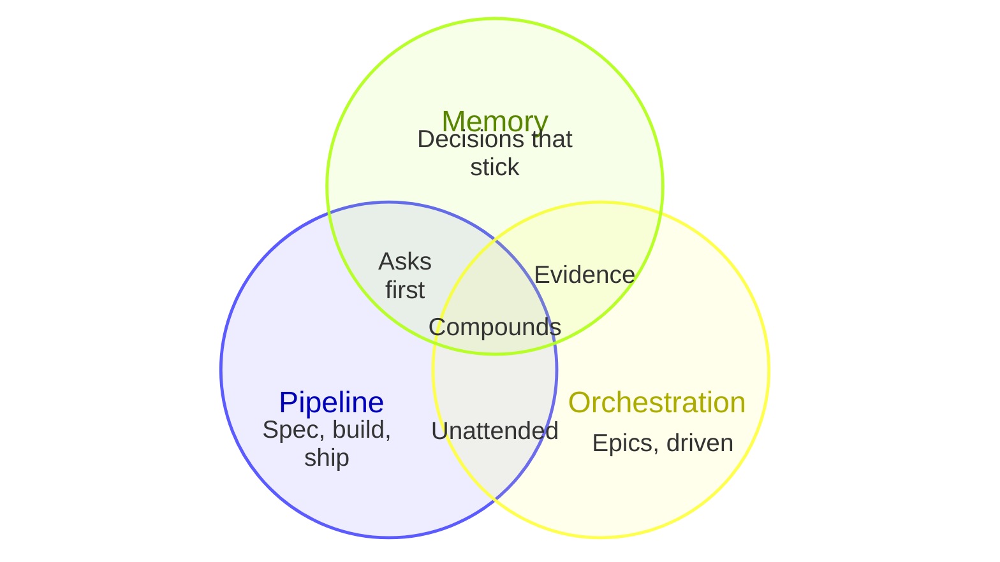

<!-- doc-type: reference -->

# Command cheatsheet

A lookup reference for the `/s:` commands and the `shipd` CLI — not a
walkthrough. New to shipd? Start with [Your first change](getting-started.md)
instead; come back here once you know the loop and just need the invocation
you forgot. Looking for a config key or a customisation surface instead?
See [Customising shipd](customise.md).

## Conventions

Flags shared across several verbs, stated once here instead of on every row
below:

- `--json` — emit machine-readable JSON instead of the text report.
- `--root DIR` — run against a repository root other than the current
  directory.

## How the skills overlap

- **Spec, build, ship** — the pipeline for one change: s:onboard,
  s:help, s:doctor, s:init, s:duck, s:plan, s:fix, s:review, s:drive, s:demo, s:gate, s:status,
  s:document, s:worktree-hooks, s:pr
- **Epics, driven** — orchestration across many changes: s:epic, s:prd,
  s:initiative, s:workspace, s:explain, s:epic-grill, s:plan-deep, s:room
- **Decisions that stick** — memory that outlives a change: s:remember,
  s:memory, s:forget
- **Unattended** — s:build, s:autopilot, s:drift
- **Asks first** — s:ask
- **Evidence** — s:research, s:video-ingest
- **Compounds** — s:teach

## /s: commands

| Command | What it does | Example |
|---|---|---|
| `/s:ask` | Ask the oracle before interrupting a human — a cited recommendation, or a queued question. See [The oracle](oracle.md). | `/s:ask Should the new endpoint require auth?` |
| `/s:autopilot <epic> [detached]` | Drive an approved epic's unplanned members to shipped PRs unattended. See [Autopilot](autopilot.md). | `/s:autopilot export-cli` |
| `/s:build [change]` | Plan, delegate to execution sub-agents, verify, and ship a change end to end. See [Build a change](build.md). | `/s:build export-json-flag` |
| `/s:demo` | Produce a branded demo video of a browser or terminal subject. See [Drive a browser and record a demo](drive-and-demo.md). | `/s:demo Record the checkout flow` |
| `/s:doctor` | Diagnose a shipd environment and run only the remedies you consent to. See [Doctor](doctor.md). | `/s:doctor` |
| `/s:init [section]` | Set up shipd in a project with a guided wizard, or run one section. See [Customising shipd](customise.md). | `/s:init config` |
| `/s:document` | Author or revise a doc against the shipd documentation standard, then lint it clean. See [Write docs](document.md). | `/s:document Rewrite docs/api-keys.md as a reference` |
| `/s:drift <change> \| --epic <slug>` | Judge whether an epic's gated plans still hold against `main` — `holds`, `revise`, or `conflict` per drifted member. See [Drift](drift.md). | `/s:drift --epic export-cli` |
| `/s:drive` | Drive a real browser to operate an app, verify a change, and optionally record a branded demo. A `manual` auth recipe, or `login <target> --manual`, lets a person log in by hand. When a step fails, `handoff` gives the person the live browser and `resume` takes it back. `session start --headed` opens the window visible from the start. See [Drive a browser and record a demo](drive-and-demo.md). | `/s:drive Verify the checkout flow still works` |
| `/s:duck` | Talk an idea through with an adversarial, read-only rubber-duck critic before planning it. See [Rubber duck](duck.md). | `/s:duck Should the queue be per-tenant?` |
| `/s:epic` | Decompose a feature into an epic of member changes with shared decisions. See [Epics](epics.md). | `/s:epic Add multi-tenant billing` |
| `/s:epic-grill <epic>` | Plan every unplanned member of an epic, ask every open decision once, then gate the plans together. See [Epic grill](epic-grill.md). | `/s:epic-grill export-cli` |
| `/s:explain <epic>` | Read a shipd epic through the engine and explain what it is for and where it stands. See [Epics](epics.md). | `/s:explain autonomous-delivery` |
| `/s:fix` | Debug a reported problem against the spec library, then fix the drifted code. See [Fix a bug](fix.md). | `/s:fix The export command crashes on empty input` |
| `/s:forget` | Remove a captured preference from the personal memory store. See [Personal memory](memory.md). | `/s:forget my vim preference` |
| `/s:gate` | Install the semantic review gate in a repository end to end. See [Review gate](copilot-review.md). | `/s:gate` |
| `/s:help <question>` | Answer a how-to question about shipd from its own skills. See [Ask shipd for help](help.md). | `/s:help How do I handle a mid-spec change?` |
| `/s:initiative <new\|list\|review\|set> [args]` | Author, list, review, or attach workspace initiatives. See [Initiatives](initiatives.md). | `/s:initiative list` |
| `/s:memory` | List the preferences captured in the personal memory store. See [Personal memory](memory.md). | `/s:memory` |
| `/s:onboard [next\|back]` | Run the guided nine-step shipd tour. See [Guided tour](onboard.md). | `/s:onboard next` |
| `/s:plan` | Converge context into an execution-ready spec, then stop. See [Plan a change](plan.md). | `/s:plan Add a --json flag to the export command` |
| `/s:plan-deep <change> \| <epic> [members]` | Walk a spec's riskiest pieces step by step, edit in place, and re-gate. See [Plan a change](plan.md). | `/s:plan-deep export-cli parser-flags` |
| `/s:pr [--ticket <id>] [--draft] [--base <ref>]` | Write a pull request's title and body, then create or update it. See [Pull requests](pr.md). | `/s:pr --ticket ABC-12` |
| `/s:prd [slug]` | Interview for a workspace PRD — the outcomes an idea should deliver — before an epic decomposes it. See [PRDs](prd.md). | `/s:prd Add self-serve billing` |
| `/s:remember` | Capture a durable user preference into the personal memory store. See [Personal memory](memory.md). | `/s:remember I prefer terse commit messages` |
| `/s:research` | Turn a question into a cited research report an epic can link. See [Research](research.md). | `/s:research What are common approaches to rate limiting?` |
| `/s:review [target]` | Run a semantic review of local changes before you push. See [The semantic review](semantic-review.md). | `/s:review` |
| `/s:room [pr]` | Take this agent's turn in a pull request's room: wait for a task, then reply in prose. See [Multi-agent PR](multi-agent-pr.md). | `/s:room 412` |
| `/s:status <status\|validate\|set-status\|pipeline> [args]` | Report or change a spec's lifecycle status through the guarded CLI. See [Plan a change](plan.md). | `/s:status status export-json-flag` |
| `/s:teach [<change> Q<n>]` | Distill spec artifacts and answered queue entries into the workspace wiki. See [The wiki](wiki.md). | `/s:teach` |
| `/s:video-ingest <video-or-slug>` | Turn a screen recording into a grounded, cited intent brief. See [Video ingest](video-ingest.md). | `/s:video-ingest recording.mp4` |
| `/s:workspace <init\|show\|clone\|sync>` | Set up and inspect the shipd workspace. See [Workspaces](workspaces.md). | `/s:workspace show` |
| `/s:worktree-hooks` | Author and register a script a fresh worktree runs after creation. See [Worktrees and hooks](worktrees.md). | `/s:worktree-hooks copy .env.example into every new worktree` |

## shipd CLI

| Command | What it does | Example |
|---|---|---|
| `init [status] [--root DIR]` | Create the content directory layout and ignore and untrack the local state files; safe to re-run. `status` writes nothing: it reports `first-run`, `layout-missing`, or `ready` and the action to take. See [Customising shipd](customise.md). | `shipd init` |
| `list [kind] [--all]` | Spec artifacts across the root and its worktrees — kind: `changes` (default), `epics`, `verified`, `research`, `video`, or `docs`; `--all` (changes only) adds the applied ones. See [Plan a change](plan.md). | `shipd list` |
| `status [change]` | A change's status and progress. See [Plan a change](plan.md). | `shipd status` |
| `locate [change]` | Where an installed change lives. See [Plan a change](plan.md). | `shipd locate` |
| `related <term> [term...]` | Spec artifacts ranked by term-hit count. See [Fix a bug](fix.md). | `shipd related statusline` |
| `search <term> [term...]` | The same ranking over a wider corpus: every related surface plus initiative briefs and this repo's git-tracked files. See [PRD reference](prd-reference.md). | `shipd search statusline` |
| `epic <slug>` | An epic's status, metadata, and member states. See [Epics](epics.md). | `shipd epic autonomous-delivery` |
| `prd [slug]` | A PRD's report and citing epics; bare: the workspace's PRD roster. See [PRDs](prd.md). | `shipd prd` |
| `workspace [init\|sync\|team]` | The workspace root, its projects, and initiatives; `init` creates one, `sync` materializes its members, `team` builds a nested team workspace. Needs an ancestor `.shipd-config.json` declaring `workspace` (see `/s:workspace init`). See [Workspaces](workspaces.md). | `shipd workspace` |
| `wiki [init]` | The wiki store; `init` scaffolds one. See [The wiki](wiki.md). | `shipd wiki` |
| `config [set\|unset\|check]` | The layered configuration this root resolves; `set` and `unset` change a key; `check` validates every layer. See [Customising shipd](customise.md). | `shipd config` |
| `board [text] [--epic EPIC] [--interval N]` | The delivery board (default: full-screen). See [Build a change](build.md). | `shipd board text` |
| `render [output] [file] [--plain\|--ascii]` | Markdown with its mermaid diagrams drawn as text (default: full-screen); `--plain` unstyled, `--ascii` ASCII-only lines. See [PRD reference](prd-reference.md). | `shipd render output docs/what-is-shipd.md --plain` |
| `metrics [summary\|record-flow\|forecast\|rollup]` | Delivery metrics (default: summary). See [Statusline and telemetry](statusline-and-telemetry.md). | `shipd metrics` |
| `lint [change] [--epic EPIC] [--initiative INITIATIVE] [--workspace] [--wiki]` | Structurally validate specs and change deltas. See [Plan a change](plan.md). | `shipd lint` |
| `worktree <change> [--fresh]` | Create the change's worktree, then run the configured post-worktree-scripts. See [Worktrees and hooks](worktrees.md). | `shipd worktree add-login-flow` |
| `room <verb> <pr>` | The pull request's room: `join`, `list`, `message`, `close`, `watch`, `whoami`, `run`. Needs a pull request and a signed-in `gh`. See [Run agents in a pull request's room](room-run.md). | `shipd room list 412` |
| `doctor [--fix]` | Preflight this environment for shipd; `--fix` provisions local tooling automatically. See [Doctor](doctor.md). | `shipd doctor --fix` |
| `statusline [install\|layout] [--show SEG] [--hide SEG] [--force]` | Register the shipd statusline above any existing one, and choose its segments and lines. See [Statusline and telemetry](statusline-and-telemetry.md). | `shipd statusline` |
| `copilot [add\|update\|remove] [--force]` | Maintain the Copilot code-review skill — the `/s:gate` merge gate — in a repo. See [Review gate](copilot-review.md). | `shipd copilot` |
| `gate rules [apply]` | Report, or apply, the repository's merge-rules ruleset. See [Pull requests](pr.md). | `shipd gate rules` |
| `vendor [add\|remove] [--force]` | Maintain a vendored per-repo shipd install. See [Install](install.md). | `shipd vendor` |
| `harness [list\|show\|add\|remove\|status] [ids...] [--all] [--user] [--force]` | The harness registry, and the generated command files in a repo or in your home; `--all` acts on every harness in it. See [Harnesses](harnesses.md). | `shipd harness list` |
| `install` | Pick your harnesses and install their commands. See [Install](install.md). | `shipd install` |
| `update [--check]` | Report or install a newer published plugin version. See [Install](install.md). | `shipd update --check` |
