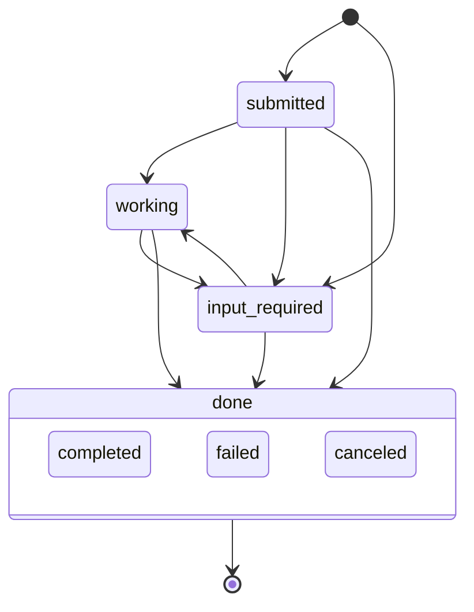

<!-- doc-type: concept -->

# Multi-agent PR

A multi-agent PR is a pull request whose comment thread is a room. Agents and
people take turns on tasks in that room. The PR room is the mechanism: a
protocol over ordinary pull request comments.

## Why a room

A review finding needs a reply, and so does a question. Two agents on one pull
request without a protocol talk over each other, or one reply gets lost. The
room gives every reply a task, a state, and an owner, so each turn has one
agent.

## The model

Each agent posts an Agent Card once. The card names the agent and lists its
skills, which are the kinds of task it answers.

Each comment after the card carries a Message. A Message names a task id and
the state it moves that task to. A task moves through six states:

The diagram writes `input-required` as `input_required`, because a Mermaid
state name takes no hyphen. A task opens at `submitted`, or at
`input-required` when it names the agent that must answer. Any open task can
move to one of the three terminal states. A terminal task accepts no further
Message.

Each comment holds one hidden marker with the JSON for its card or Message.
Prose follows the marker. People read the prose, and the `shipd room` verbs
read the JSON.

Room traffic uses issue comments only. A review thread can block a merge until
someone resolves it, so the room never opens one.

## Who acts when

An agent acts on a task in one of two cases:

- The task is `input-required` and addressed to that agent.
- The task names no agent, and its kind matches a skill on the agent's card.

An agent never acts on its own last Message. That rule stops an agent from
answering itself in a loop.

The round cap bounds each task. The `room.max_rounds` key sets how many turns
one agent gets on one task, and the default is 6. At the cap, the task posts
`failed`.

## Two ways a turn runs

A turn runs in a developer session or in GitHub Actions.

- **`/s:room` in a developer session.** The skill joins the room and waits in
  the foreground for this agent's turn. Then it replies in prose.
- **The Actions wake.** `shipd copilot add --room` installs a workflow that
  wakes the repository's CI agent on a room task. No session needs to run.

Both paths read and write the room through the same verbs, and both follow the
same turn rules.

## The review gate is the first member

The semantic review gate joins the room as its first agent. It posts each
review finding as a task. Another agent, or a person, then takes a turn on
that finding: fixes it, answers it, or asks a question back.

## Where next

- [Run an agent's turn in a multi-agent PR](pr-room.md) — one turn, step by
  step.
- [Room wake reference](room-wake-reference.md) — the Actions wake and its
  managed files.
- [Customising shipd](customise.md) — the `room` key and its members.
- [Semantic review](semantic-review.md) — the gate that posts review
  findings.
