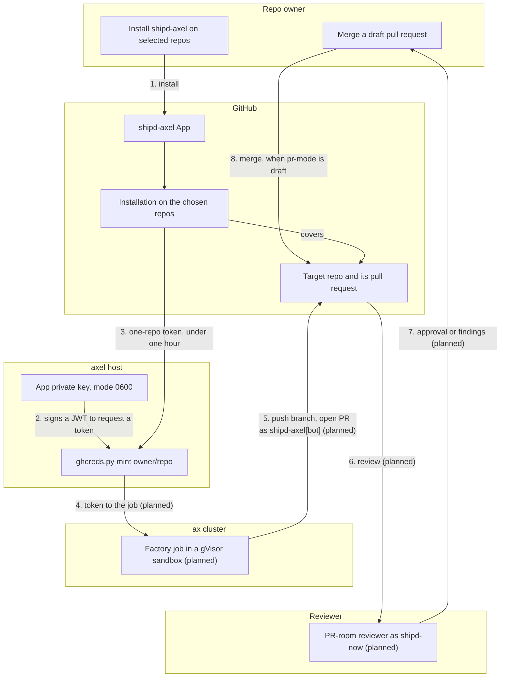

<!-- doc-type: concept -->

# The shipd-axel GitHub App

`shipd-axel` is a public GitHub App that lets the shipd software factory
push branches and open pull requests on your repos. The `shipd-now` account
owns it. Any account can install it, and it acts only on the repos you pick.

## What it is for

The software factory runs on axel, a self-hosted ax cluster. ax is Google's
agent runtime, and each job runs in an Agent Substrate gVisor sandbox. A job
runs shipd's `/s:plan` then `/s:build` against a target repo. It pushes a
`change/<slug>` branch and opens a pull request there. The App gives the job
its GitHub identity, so every push shows the author `shipd-axel[bot]`.

## What it can touch

The App asks for three repository permissions and nothing else:

- **Contents** — read and write, to push the job's branch.
- **Pull requests** — read and write, to open and update the pull request.
- **Metadata** — read, which GitHub requires of every App.

It holds no organization or account permissions, no webhook, no events and no user authorization.

## How a job gets a token

The axel host mints a fresh token for every job:

1. `server/credentials/ghcreds.py mint <owner/repo>` signs a short JWT with
   the App's private key.
2. The script finds the App's installation for that repo.
3. GitHub issues a token limited to that one repo and the three permissions.

The token expires within an hour, and the host caches none. The private key
lives only on the host, in `~/.config/axel/` with mode 0600, pushed from
1Password. No long-lived credential goes into a sandbox's task definition.
Minting fails on a repo without the App: `shipd-axel is not installed on <repo>`.

## Who reviews

The planned PR-room reviewer agents, run through shipd's `/s:room`, act as
the `shipd-now` user. The host checks that the reviewer token belongs to
`shipd-now` before use, so author and reviewer are different accounts. The
repo's shipd `pr-mode` decides the merge: `auto` arms auto-merge, and `draft`
opens a draft pull request that a person merges.

## How it works

## What is live and what is planned

Live today: the App and per-job token minting on the axel host. Planned, as
members of the `software-factory` epic: the factory job, the orchestrator,
the egress policy, and the PR-room reviewers. The orchestrator and the egress
policy will deliver the token into the sandbox.

## Install and remove

To install, open [the App's page](https://github.com/apps/shipd-axel). Choose
**Install**, then **Only select repositories**, and pick the repos.

To remove it or change its repos, open **Settings → Applications →
Installed GitHub Apps**. Choose **Configure** next to shipd-axel, then
uninstall it or edit its repo list. Uninstalling stops all minting at once.
