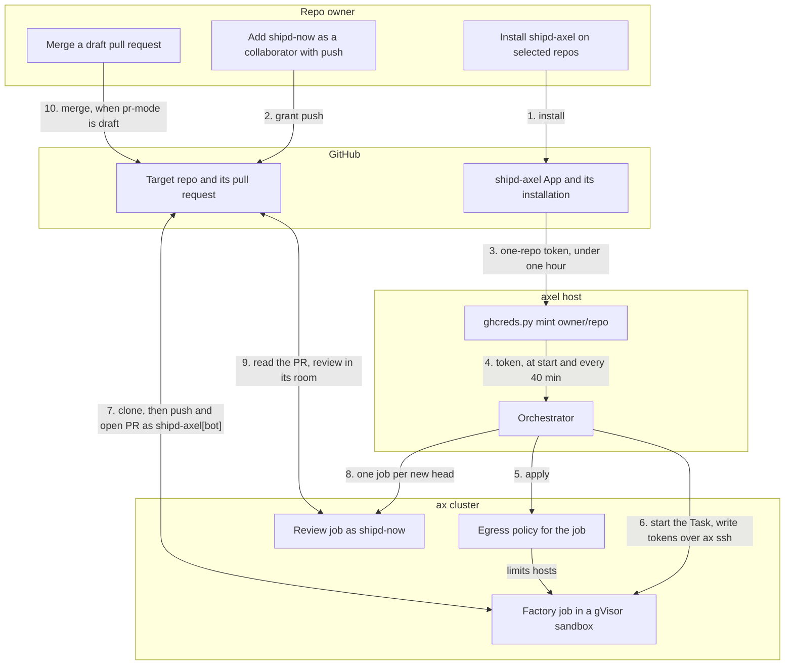

<!-- doc-type: concept -->

# The shipd-axel GitHub App

`shipd-axel` is a public GitHub App that lets the shipd software factory
push branches and open pull requests on your repos. The `shipd-now` account
owns it. Any account can install it, and it acts only on the repos you pick.

## What it is for

The software factory runs on axel, a self-hosted cluster of Google's ax agent
runtime, with each job in an Agent Substrate gVisor sandbox. A job runs shipd's
`/s:plan` then `/s:build` against a target repo, pushes a `change/<slug>`
branch, and opens a pull request. The App gives the job its GitHub identity, so
the job pushes the branch and opens the pull request as `shipd-axel[bot]`.

## What it can touch

The App holds no organization or account permissions, no webhook, no events
and no user authorization. It asks for three repository permissions only:

- **Contents** — read and write, to push the job's branch.
- **Pull requests** — read and write, to open and update the pull request.
- **Metadata** — read, which GitHub requires of every App.

## How a job gets its credentials

The orchestrator on the axel host mints a fresh token when a job starts, and
every 40 minutes while a long job runs:

1. `server/credentials/ghcreds.py mint <owner/repo>` signs a short JWT with
   the App's private key.
2. The script finds the App's installation for that repo.
3. GitHub issues a token limited to that one repo and the three permissions.

Each token expires within an hour. The private key
lives only on the host, in `~/.config/axel/` with mode 0600, pushed from
1Password. Minting fails on a repo without the App: `shipd-axel is not installed on <repo>`.

No long-lived credential goes into a sandbox's task definition. The
orchestrator applies the job's egress policy, then writes the one-repo GitHub
token and the Claude token as files inside the sandbox over `ax ssh`. Egress
injection, where the gateway adds the real credential and the sandbox holds
only a placeholder, is proven but not yet the orchestrator's delivery mode.

## Who reviews

Reviews run as the `shipd-now` user, so author and reviewer are different
accounts. The host checks that the reviewer token belongs to `shipd-now`. The
orchestrator watches each pull request a succeeded change job opened, or its
`POST /reviews` route registered. For every new head commit, it runs one short
review job through shipd's `/s:room`, until the pull request merges or closes.
The repo's shipd `pr-mode` decides the merge: `auto` arms auto-merge, and
`draft` opens a draft that a person merges. Only `draft` mode has an end-to-end
test so far, and GitHub won't arm auto-merge on a repo with no required checks.

## Install and remove

To install, open [the App's page](https://github.com/apps/shipd-axel). Choose
**Install**, then **Only select repositories**, and pick the repos. For
reviews, add `shipd-now` to each repo as a collaborator with **push (write)**
access. The App alone gives factory pull requests but no reviews.

To remove it or change its repos, open **Settings → Applications →
Installed GitHub Apps**. Choose **Configure** next to shipd-axel, then
uninstall it or edit its repo list. Uninstalling stops all minting at once.
Removing the `shipd-now` collaborator stops new reviews on that repo.
