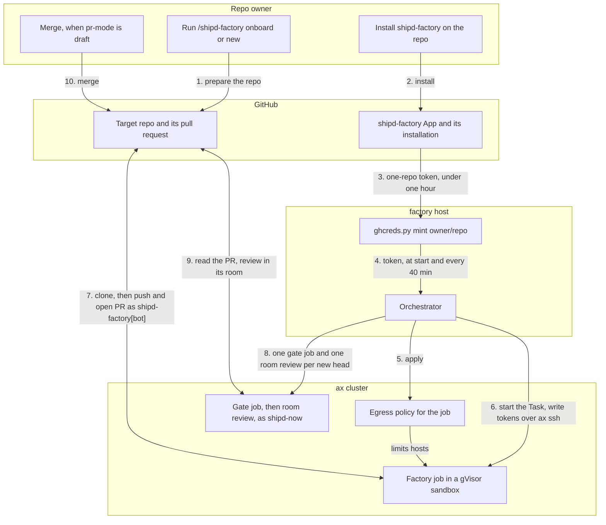

<!-- doc-type: concept -->

# The shipd-factory GitHub App

> **Beta, invite only:** [Run your own factory host](shipd-factory-setup.md).

`shipd-factory` is a public GitHub App that lets the shipd software factory
push branches and open pull requests on your repos. The `shipd-now` account
owns it. Any account can install it; it acts only on repos you pick.

## What it is for

The factory runs on a self-hosted factory host running Google's ax agent
runtime, with each job in an Agent Substrate gVisor sandbox. A job runs shipd's
`/s:plan` then `/s:build`, pushes a `change/<slug>` branch, and opens a pull
request as `shipd-factory[bot]`.

## Permissions and credentials

The App holds no organization or account permissions, no webhook, no events and
no user authorization. It asks for three repository permissions only: Contents
read and write, Pull requests read and write, and Metadata read.

The orchestrator mints a fresh token when a job starts, and every 40 minutes
after. Each token covers one repo and expires within an hour. The private key
stays on the host in `~/.config/shipd-factory/`, mode 0600. Minting on a repo
without the App fails with `ghcreds: shipd-factory is not installed on <repo>`.
The orchestrator applies the egress policy, then writes the tokens into the
sandbox over `ax ssh`.

## Set up a repo

`/shipd-factory onboard <owner/repo>` prepares an existing repo, and
`/shipd-factory new <name>` creates a private repo first. When a step needs your
consent, the skill prints the exact command and waits.

1. The default branch needs a check named `ci`; onboarding stops without one.
2. You [install the App](https://github.com/apps/shipd-factory) on the repo, the
   one manual step: GitHub allows no API install.
3. `shipd-now` gets an invite with push access, and accepts it.
4. The skill writes the `merge` rules to `.shipd-config.json` and applies the
   `shipd merge rules` ruleset. It needs 1 approval, resolved threads, and
   checks `ci`, `semantic-review` and `room-review/shipd-factory-reviewer`.
5. One onboarding pull request opens; the factory reviews and merges it.

## Reviews and author fixes

Reviews run as `shipd-now`: one gate job and one room review per new head.
With `pr-mode: auto`, GitHub merges once the rules hold; with `draft`, a person
merges. A repo opts in to author fixes with `"factory": {"author_fixes": true}`
in `.shipd-config.json` on its default branch, so a pull request cannot opt
itself in. The host must also allow it, and its default is off. An `author` job
then fixes a finding as `shipd-factory[bot]`, at most 3 rounds per pull request.

## What the live runs proved

- **`pr-mode: auto`.** On 2026-11-01, [unkannybanny #44](https://github.com/mikkel-bergmann/unkannybanny/pull/44) merged with no human action.
- **Author loop.** On 2026-11-03, seeded [unkannybanny #47](https://github.com/mikkel-bergmann/unkannybanny/pull/47) got a fix-required gate, an author fix and a passing re-review, then merged with no human action.
- **New repo.** On 2026-11-03, the first pull request on a repo made with
  `/shipd-factory new` merged with no human action.

## Remove

In **Settings → Applications → Installed GitHub Apps**, choose **Configure**
next to shipd-factory, then uninstall it, which stops all minting. Removing
the `shipd-now` collaborator stops new reviews.
